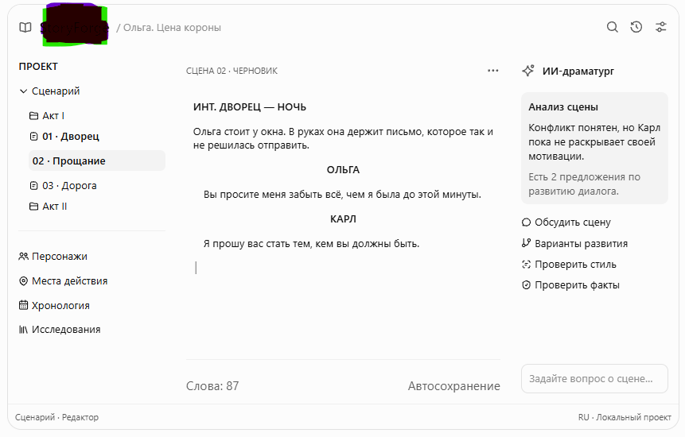

# Библия проекта

**DialogistIQ** — интеллектуальная творческая студия писателя

| | |
|---|---|
| Версия | 1.7 |
| Дата | 2026-11-04 |
| Статус | Основной документ проекта, единственный источник истины |
| Сведено из | `TZ.odt` (концепция продукта, v1.0), `prompt_aufgabe.txt` (ТЗ на MVP), решения владельца продукта |

---

## 0. Как пользоваться этим документом

- Это **главный документ проекта**. Если код, задача или другой документ ему противоречит, верна библия. Исправлять нужно либо код, либо библию: осознанно и с записью в журнале изменений (§20).
- Исходные документы (`TZ.odt`, `prompt_aufgabe.txt`) остаются в репозитории как история и больше не служат источником требований.
- Слова **ДОЛЖНО**, **НЕЛЬЗЯ** и **СЛЕДУЕТ** обозначают обязательность: «ДОЛЖНО» и «НЕЛЬЗЯ» — жёсткие требования, «СЛЕДУЕТ» — сильная рекомендация, отступать от которой можно только с обоснованием.
- ИИ-агент-разработчик ДОЛЖЕН прочитать разделы 2, 5.5, 12, 13, 14 и 16 до начала любой задачи.
- **Название продукта — DialogistIQ**, идентификатор приложения — `io.github.ewigprog-ui.dialogistiq`. В коде название берётся только из единой константы (§14).

---

## 1. Видение

Настольное приложение, которое становится **полноценной рабочей средой автора** и сопровождает весь творческий процесс: от первой идеи и мозгового штурма до сценария, готового к отправке продюсеру, или романа, подготовленного к публикации.

Продукт объединяет четыре вещи:

1. **Библиотеку произведений**: все проекты автора в одном месте.
2. **Профессиональный сценарный редактор**: готовые форматы блоков, автоформатирование, хронометраж по американскому стандарту (как Final Draft).
3. **Мастерскую разработки**: карточки, структура, мозговой штурм, материалы, персонажи (как Scrivener).
4. **ИИ-команду, которая знает произведение**: несколько ролей (от партнёра по мозговому штурму до жёсткого критика), которые помнят персонажей и работают с драматургией на уровне всего текста.

**Главное отличие** — *единая модель художественного мира* («память произведения»). Ею пользуются редактор, инструменты разработки, статистика и все ИИ-роли.

### Целевые пользователи
- Сценаристы: кино, сериалы, короткий метр.
- Романисты, особенно авторы больших форм (500+ страниц).
- Авторы исторических и документальных произведений, которые работают с источниками.

### Модель распространения
**Свободный некоммерческий продукт.** Любой может бесплатно скачать его и пользоваться им. У продукта нет платных функций, подписок и обязательных учётных записей, и нет собственного облачного сервера. Облачный ИИ работает только на **ключах самого автора**. Без ключей полностью доступны локальные модели (Ollama, LM Studio).

**Лицензия: GPL-3.0-or-later, открытый исходный код.** Любой может использовать, изучать, изменять и распространять продукт, но производные версии тоже обязаны оставаться свободными под GPL. К каждому выпуску прилагается ссылка на исходный код.

### Языки (по приоритету)
1. **Немецкий (DE)** — основной язык интерфейса и первый целевой рынок.
2. **Английский (EN)**
3. **Русский (RU)**

---

## 2. Принципы продукта (неизменны)

Эти правила действуют на всех этапах. Нарушение любого из них считается дефектом.

1. **Автор решает.** ИИ предлагает, но НИКОГДА не меняет текст или канон без явного подтверждения автора.
2. **ИИ показывает основания.** Каждый вывод о произведении ДОЛЖЕН ссылаться на конкретные сцены, карточки или источники, по которым можно перейти одним кликом.
3. **Творческий приём — не ошибка.** ИИ ДОЛЖЕН различать факт мира, слова персонажа, предположение автора и исторический факт (§10.2).
4. **Локально по умолчанию.** Проекты хранятся на диске автора в открытом документированном формате. Работа без интернета возможна, если подключена локальная модель.
5. **Прозрачная приватность.** Перед первой отправкой текста в облачный сервис автор ДОЛЖЕН получить предупреждение: что именно уходит и куда. Для проекта можно включить режим «только локальные модели».
6. **Прозрачная стоимость.** Расход токенов и стоимость облачных запросов ДОЛЖНЫ быть видны автору.
7. **Модель и роль выбираются под задачу.** Автор назначает модель каждому виду работы и выбирает ИИ-роль под настроение и цель.
8. **Без зависимости от платных надстроек.** Нельзя использовать коммерческие расширения сторонних библиотек.
9. **Тишина при письме.** Любую панель можно скрыть. Режим без отвлекающих элементов доступен всегда.
10. **Свободно и честно.** Продукт бесплатен и не требует регистрации. Телеметрия выключена по умолчанию и включается только по явному согласию автора.
11. **Чистые лицензии.** Каждая сторонняя библиотека, шрифт, звук и иконка ДОЛЖНЫ разрешать бесплатное распространение в составе продукта (§13).
12. **Тонкая настройка.** Автор подстраивает среду под себя: шрифты, цвета, звуки, клавиши. При этом стандарт печати сценария не нарушается (§8).
13. **Бережный дизайн.** Интерфейс рассчитан на многочасовую ежедневную работу. Он щадит глаза и внимание автора, а также ресурсы компьютера (§5.5).
14. **История не теряется.** Каждый проект ведёт полную историю версий во встроенном git. Любое состояние можно вернуть (§7.5).

---

## 3. Ключевой сценарий (эталон продукта)

> Автор пишет историческую драму о княгине Ольге Вюртембергской («Ольга. Цена короны»). Он начинает с мозгового штурма с ИИ, собирает карточки сцен, добавляет биографические источники, описывает характер Ольги и пишет сцены.
>
> Через несколько недель он спрашивает ИИ:
> *«Найди все сцены, где Ольга поступает вопреки своему характеру. Объясни, какие противоречия оправданы её развитием, а какие выглядят авторскими ошибками. Предложи исправления, сохранив историческую достоверность».*
>
> Программа находит конкретные сцены, сопоставляет их с карточкой персонажа и источниками, разделяет «развитие» и «ошибку», предлагает правки с обоснованием и ссылками. Автор принимает часть предложений, отклонённые попадают в историю работы.

Этот сценарий — **сквозной приёмочный тест продукта**.

---

## 4. Глоссарий

| Термин | Значение |
|---|---|
| **Библиотека** | Список всех проектов автора со стартовым экраном, поиском и фильтрами |
| **Проект** | Одно произведение: сценарий или роман. На диске это папка (§15) |
| **Биндер** | Дерево структуры проекта в левой панели |
| **Документ** | Единица текста в биндере: сцена, глава или заметка |
| **Элемент (блок)** | Тип абзаца сценария: заголовок сцены, действие, персонаж, реплика и т. д. (§7.2) |
| **Сцена** | Минимальная драматургическая единица. У неё есть текст и метаданные |
| **Карточка** | Представление сцены, идеи или персонажа на доске разработки |
| **Доска** | Свободное поле для карточек: пробковая доска сцен или доска мозгового штурма |
| **Сущность мира** | Персонаж, место действия, событие хронологии, предмет, правило мира |
| **Канон** | Факты и решения, утверждённые автором. Обязательны для ИИ |
| **Память произведения** | Вся структурированная модель произведения (§10) |
| **Роль ИИ** | Преднастроенный характер ИИ-помощника: критик, драматург, друг и др. (§11.5) |
| **Задача ИИ** | Тип работы (продолжить, переписать, проверить логику). Каждой задаче назначается модель |
| **Провайдер** | Источник моделей: OpenAI, Anthropic, Ollama, LM Studio, произвольный endpoint |
| **Цвет персонажа** | Сквозной цвет, которым персонаж отмечен везде: в репликах, карточках, статистике, таймлайне |
| **Восьмушка** | 1/8 страницы — отраслевая единица длины сцены в американском производстве |
| **Версия** | Сохранённое состояние проекта (git-коммит). **Именованная версия** — git-тег («Черновик 1») |
| **Вариант** | Альтернативная линия развития проекта (git-ветка), например другой финал |

---

## 5. Интерфейс

### 5.1. Библиотека проектов (стартовый экран)

Программа ведёт **много проектов**. Библиотека — это стартовый экран и «книжная полка» автора.

- Отображение плиткой (обложка-цвет, название, тип, статус, объём) или списком. Сортировка по дате изменения, названию, статусу.
- Поиск по названию и тегам. Фильтры: тип (сценарий / роман), статус (*идея → разработка → черновик → редактура → готов*), теги, архив.
- Действия: создать (из шаблона), открыть, дублировать, переименовать, архивировать, убрать из библиотеки (файлы не удаляются), удалить (в корзину ОС), показать папку на диске, импортировать (Fountain; позже FDX).
- **Шаблоны проектов:** полнометражный фильм, серия 45 мин, серия 60 мин, короткий метр, роман. Шаблон задаёт структуру биндера, акты и целевой объём.
- По умолчанию проекты создаются в `Документы/DialogistIQ/`, но проект может лежать где угодно. Библиотека хранит только ссылки на папки (§15).
- Если папка проекта перемещена или недоступна, проект помечается «не найден» и предлагается указать новый путь.
- В одном окне открыт один проект. Переход между проектами — через библиотеку (`Ctrl+O`). Несколько окон — позже.
- Позже: поиск по всем проектам библиотеки.

### 5.2. Главное окно проекта



*Концептуальный макет. Пропорции и оформление можно адаптировать, композиция обязательна. Логотип на макете закрыт: название ещё не выбрано. Русские подписи — пример, основной язык интерфейса немецкий.*

| Область | Назначение | Содержимое |
|---|---|---|
| **Слева: Проект** | Управление произведением | Биндер (Сценарий → Акты → Сцены), затем разделы: Разработка, Персонажи, Места действия, Хронология, Исследования |
| **Центр: Редактор** | Письмо | Заголовок документа («СЦЕНА 02 · ЧЕРНОВИК»), панель выбора элемента, текст, внизу живая статистика и статус автосохранения |
| **Справа: ИИ** | Работа с ИИ | Выбор роли («ИИ-драматург», «Жёсткий критик»…), анализ текущей сцены, быстрые действия, поле вопроса |

**Верхняя строка:** иконка и название (DialogistIQ), хлебные крошки «Библиотека / Проект», переключатель режимов, поиск, история версий, настройки.

**Строка состояния (живая статистика):** страница X из Y · хронометраж ≈ мм:сс · слова · текущая сцена N из M · слова за сессию / дневная цель · активная модель (локально/облако) · язык.

Требования:
- Обе боковые панели можно скрыть и изменить их ширину. Состояние запоминается.
- Режим без отвлечений: остаются только текст и минимальный счётчик.
- Языки интерфейса: **DE (по умолчанию), EN, RU**. Строки интерфейса берутся только из файлов локализации.
- **Язык интерфейса и язык произведения настраиваются отдельно.** ИИ отвечает на языке произведения, если автор не попросил иначе.

### 5.3. Рабочие режимы

| Режим | Что делает автор | Ключевые инструменты |
|---|---|---|
| **Писать** | Пишет и правит текст | Редактор с элементами сценария, горячие клавиши, автосохранение, версии (git) |
| **Разрабатывать** | Ищет идеи и строит структуру | Доска мозгового штурма, пробковая доска с карточками сцен, акты и сюжетные линии, логлайн, синопсис, тритмент (§6) |
| **Исследовать мир** | Ведёт модель мира | Карточки персонажей (с цветом), отношения, хронология, места, источники |
| **Работать с ИИ** | Анализирует и обсуждает | Чат с ролями, анализ структуры, переписывание, поиск противоречий |
| **Статистика** | Смотрит на произведение «сверху» | Таймлайн, объёмы, персонажи, прогресс (§9) |

Режимы — это разные виды **одних и тех же данных**. Перестановка карточки в режиме «Разрабатывать» меняет порядок сцен в рукописи, и наоборот.

### 5.4. Биндер

- **Сценарий:** Разработка (логлайн, синопсис, тритмент, доски) → Сценарий → Акт → Секвенция → Сцены.
- **Роман:** Разработка → Рукопись → Часть / Глава → Сцены.
- Для обоих типов: Персонажи, Места действия, Хронология, Исследования, Заметки, Корзина.
- Операции: создать, переименовать, удалить (в корзину проекта с восстановлением), перетащить (drag-and-drop) с изменением порядка и вложенности.
- Сцены в биндере можно помечать цветом и статусом. Рядом с названием видна длина сцены в восьмушках или страницах.

### 5.5. Дизайн и эргономика

Продукт рассчитан на **многочасовую ежедневную работу с текстом**. Дизайн ДОЛЖЕН снижать нагрузку на глаза, внимание, тело и компьютер. Ориентир по настроению — макет (§5.2): спокойный, светлый, без лишнего. Цвета, отступы и шрифты задаются **дизайн-токенами** (CSS-переменными). Тема — это набор значений этих токенов.

**Глаза**
- Нет чисто белого фона и чисто чёрного текста. В светлой теме тёплый «бумажный» фон (около `#F7F5F0`) и тёмно-серый текст. В тёмной теме тёмно-серый фон (около `#1C1C1E`) и светло-серый текст.
- Контраст основного текста не ниже WCAG AA (4,5:1), цель — около 7:1, но без режущей максимальной яркости. Контраст всех тем проверяется автоматически.
- Палитра интерфейса приглушённая. Насыщенные цвета используются только для смысловых акцентов: ошибка, выделение, цвет персонажа.
- **Вечерний режим:** по расписанию или по времени суток тема плавно становится теплее и темнее, синего света меньше.
- Тема по умолчанию следует настройке ОС.

**Типографика**
- Проза: строка 60–75 знаков, межстрочный интервал 1,5–1,7, шрифт для долгого чтения с экрана (например, Literata или Source Serif 4, лицензия OFL).
- Сценарий на экране — Courier Prime. Экранные размер и интервал настраиваются, печать — нет (§7.4).
- Интерфейс — спокойный гротеск (например, Inter, OFL). Масштаб интерфейса 80–200 %.

**Внимание**
- Ничто не мигает и не требует внимания без причины: никаких счётчиков «непрочитанного» и навязчивых подсказок. Уведомления тихие и не закрывают текст.
- Анимации короткие (≤ 150 мс) и функциональные. При системной настройке `prefers-reduced-motion` они отключаются.
- Раскладка стабильна: панели не прыгают, а потоковый ответ ИИ не сдвигает и не прокручивает текст в редакторе.
- Всё доступно с клавиатуры (палитра команд, горячие клавиши), это снижает нагрузку на руку.
- Автор спокоен за данные: есть автосохранение, версии и отмена действий везде.

**Тело**
- Напоминания о перерывах (по желанию, предлагаются при первом запуске): правило 20-20-20 для глаз, помодоро, мягкое «пора размяться» после N минут непрерывной работы. Напоминание откладывается одним кликом.
- Звуки по умолчанию выключены.

**Доступность**
- Есть тема высокого контраста.
- Цвета персонажей различимы при нарушениях цветовосприятия. Цвет никогда не бывает единственным признаком: рядом всегда есть инициалы или имя.
- Есть подписи для экранных дикторов и видимый фокус клавиатуры.

**Ресурсы и энергия**
- В простое приложение почти не нагружает процессор: нет фоновых опросов, обновления происходят по событиям.
- Фоновые задачи (индексация, пересказы ИИ, версии) выполняются пакетно с низким приоритетом. На батарее они откладываются.
- Тёмная тема экономит энергию на OLED-экранах.

**Бюджеты производительности** (проверяются автотестами):

| Показатель | Бюджет |
|---|---|
| Задержка ввода в сценарии на 150 страниц | < 16 мс (один кадр) |
| Холодный запуск до библиотеки | < 2 с |
| Открытие проекта на 150 страниц | < 1 с |
| Процессор в простое | ≈ 0 % |
| Память на типичный проект | < 300 МБ |
| Размер установщика (без моделей ИИ) | < 30 МБ |

---

## 6. Разработка сценария

### 6.1. Этапы разработки
Продукт поддерживает классический путь от идеи к тексту. Каждый этап — это документ или доска в разделе «Разработка» биндера:

**Идея → Логлайн → Синопсис → Тритмент → Поэпизодный план (Step Outline) → Черновик сценария**

Этапы не обязательны и не жёстко последовательны. Автор может начать с любого.

### 6.2. Пробковая доска (карточки сцен)
- Каждая сцена — карточка: заголовок, краткое содержание, цвет, статус, участники (кружки цветов персонажей), длина.
- Карточки раскладываются по актам и секвенциям (колонки) или по сюжетным линиям (дорожки).
- **Перестановка карточек меняет порядок сцен в рукописи.**
- Карточку можно создать без текста: сцена появится в рукописи как пустая заготовка с заголовком.
- Двойной клик по карточке открывает сцену в редакторе.

### 6.3. Доска мозгового штурма
- Свободное поле с карточками-идеями, группами и связями.
- **Мозговой штурм с ИИ:** автор задаёт тему («варианты финала второго акта»), выбирает роль (обычно «Партнёр по мозговому штурму» или «Креативщик») и количество вариантов. ИИ раскладывает идеи по отдельным карточкам.
- Каждую идею можно развить, разделить, отклонить или **превратить** в карточку сцены, персонажа, место или заметку.
- Режимы штурма: «много быстрых идей», «что если…», «развить идею», «противоположный вариант», «вопросы автору».
- История сессий штурма сохраняется: можно вернуться к отброшенным идеям.

---

## 7. Редактор

### 7.1. Движок
**Tiptap / ProseMirror** (только MIT-ядро, без платных Pro-расширений). Элементы сценария реализуются как отдельные типы узлов. **Описания элементов — данные (JSON), а не код**, чтобы их можно было настраивать (§8).

### 7.2. Элементы сценария

**Стандарт оформления — американский, как в Final Draft**, для всех языков произведения.

| ID | DE | EN | RU | Оформление (US-стандарт) | Печать |
|---|---|---|---|---|---|
| `scene_heading` | SZENENÜBERSCHRIFT | SCENE HEADING | ЗАГОЛОВОК СЦЕНЫ | ПРОПИСНЫЕ, от левого поля | да |
| `scene_characters` | SZENENFIGUREN | CAST LIST | ПЕРСОНАЖИ СЦЕНЫ | Список персонажей сцены; заполняется автоматически, редактируется | опция |
| `action` | HANDLUNG | ACTION | ДЕЙСТВИЕ | На всю ширину текста | да |
| `character` | FIGUR | CHARACTER | ПЕРСОНАЖ | ПРОПИСНЫЕ, отступ ~3,7″ | да |
| `parenthetical` | KLAMMERTEXT | PARENTHETICAL | РЕМАРКА | В скобках, отступ ~3,1″ | да |
| `dialogue` | DIALOG | DIALOGUE | РЕПЛИКА | Отступ ~2,5″, ширина ~3,5″ | да |
| `lyrics` | LIEDTEXT | LYRICS | ТЕКСТ ПЕСНИ | Позиция реплики, курсив | да |
| `transition` | ÜBERGANG | TRANSITION | ПЕРЕХОД | ПРОПИСНЫЕ, по правому краю | да |
| `shot` | EINSTELLUNG | SHOT | ПЛАН / КАДР | ПРОПИСНЫЕ, от левого поля | да |
| `note` | ANMERKUNG | NOTE | ПРИМЕЧАНИЕ | Выделен фоном, заметка автора | нет (опция) |
| `general` | UNFORMATIERTER TEXT | GENERAL | НЕФОРМАТИРОВАННЫЙ ТЕКСТ | Без автоформатирования | да |
| `sequence` | SEQUENZ | SEQUENCE | СЕКВЕНЦИЯ | Структурная метка; видна в биндере, на доске и таймлайне | опция |
| `act` | AKT | NEW ACT / END OF ACT | АКТ | По центру, с новой страницы (ТВ-формат) | опция |
| `dual_dialogue` | DOPPELDIALOG | DUAL DIALOGUE | ПАРАЛЛЕЛЬНЫЙ ДИАЛОГ | Две реплики в две колонки | да |
| `centered` | ZENTRIERT | CENTERED | ПО ЦЕНТРУ | Текст по центру (титры, «КОНЕЦ») | да |
| `insert` | EINBLENDUNG | INSERT / SUPER | ТИТР / ВСТАВКА | Надпись в кадре, ПРОПИСНЫЕ | да |
| `page_break` | SEITENUMBRUCH | PAGE BREAK | РАЗРЫВ СТРАНИЦЫ | Принудительный разрыв | да |

Отдельные документы проекта: **титульный лист** (название, автор, «по мотивам», контакты, версия/дата) — по американскому стандарту.

Режим романа: заголовок главы, абзац, разделитель сцен, цитата/эпиграф, примечание.

### 7.3. Как применять элементы (легко и быстро)
- **Логика Final Draft:** Enter и Tab переключают элемент (после Character идёт Dialogue, после Dialogue — Action или следующий Character; Tab в пустом Action превращает его в Character и т. д.). Таблица переходов настраивается.
- **Горячие клавиши:** `Ctrl+1…Ctrl+0` и сочетания с `Alt` для каждого элемента, переназначаются в настройках.
- Выпадающий список элементов на панели редактора и в строке состояния. Текущий элемент виден всегда.
- Палитра команд (`Ctrl+K`): «элемент: текст песни» и т. п.
- **Автодополнение:** имена персонажей, места, `INT./EXT.`, время суток, переходы (`CUT TO:`), расширения `(V.O.)`, `(O.S.)`, `(CONT'D)`.
- **Ключевые слова заголовка сцены** распознаются на языке произведения: `INT./EXT.`, `INNEN/AUSSEN`, `ИНТ./НАТ.`, время суток: DAY/NIGHT, TAG/NACHT, ДЕНЬ/НОЧЬ.
- Вставка «сырого» текста с автоматическим распознаванием элементов (по правилам Fountain).
- **Совместимость с Fountain:** импорт и экспорт; у каждого элемента есть соответствие в Fountain (`note` → `[[…]]`, `sequence`/`act` → секции `#`, `lyrics` → `~`, `centered` → `>…<`).

### 7.4. Пагинация и хронометраж
- **1 страница ≈ 1 минута экранного времени** (верно для американского стандарта).
- **Собственный модуль расчёта страниц**, без Tiptap Pages. Страницы считаются по метрикам стандарта, а не по экранной отрисовке. Поэтому экранные шрифты и цвета (§8) не влияют на число страниц.

| Параметр | Значение |
|---|---|
| Бумага | US Letter 8,5″ × 11″ по умолчанию; A4 — опция проекта |
| Шрифт печати | Courier Prime 12 pt (лицензия OFL), 6 строк на дюйм, ~55 строк на странице. В Courier Prime нет кириллицы, поэтому кириллица выводится шрифтом **Cousine** с той же шириной знака 0,6 em: моноширинность и подсчёт страниц сохраняются |
| Поля | слева 1,5″, справа ~1″, сверху и снизу 1″ |
| Отступы элементов | см. таблицу §7.2 |
| Номер страницы | справа сверху с точкой («12.»), на первой странице не ставится |
| Перенос реплики | `(MORE)` внизу страницы, `ИМЯ (CONT'D)` вверху следующей |
| Номера сцен | опционально (production draft) |

**Строки на экране переносятся так же, как при печати.** Если окно или панель уже страницы, сценарная страница на экране масштабируется целиком, а не перестраивает строки. Иначе автор видел бы другие переносы и другие страницы, чем в PDF.

Значения с «~» ДОЛЖНЫ сверяться с эталонными PDF из Final Draft (`/tests/fixtures`). Допуск по числу страниц — ±1 на 100 страниц.

### 7.5. Сохранение и версии (встроенный git)
- **Автосохранение** (по умолчанию через ~1,5 с после паузы в наборе, плюс при потере фокуса и закрытии). Данные нельзя терять даже при аварийном завершении.
- **Всё поведение автосохранения и версий настраивает автор** (§8.4). Значения в этом разделе — только значения по умолчанию.
- **Каждый проект — git-репозиторий.** Он создаётся автоматически. Установленный git не нужен: он встроен в приложение. Знать git автору тоже не нужно, в интерфейсе это «версии», «варианты», «история».
- **Автосохранение — не коммит.** Файлы записываются часто, а версии (коммиты) создаются по событиям, чтобы история оставалась читаемой:
  - вручную: «Сохранить версию» (`Ctrl+Shift+S`) с комментарием;
  - автоматически после N минут активной работы (по умолчанию 15) и при закрытии проекта, если есть изменения;
  - автоматически перед применением правки ИИ, перед импортом и перед восстановлением.
- **Именованные версии** (git-теги): «Черновик 1», «Fassung für Produktion», «Для продюсера».
- **История** проекта и отдельного документа. Версии сравниваются **по сценам и элементам сценария**, а не построчным diff файлов. Можно восстановить документ или весь проект. Восстановление создаёт новую версию, история не переписывается.
- **Варианты** (git-ветки): альтернативная линия, например другой финал. Можно переключаться между вариантами и переносить сцены из одного в другой.
- **Резервная копия** в собственный удалённый репозиторий автора (например, приватный на GitHub). Это опция, которая включается только явной настройкой. Отправка (push) без согласия автора не выполняется (принципы 4 и 10).
- **Внешние изменения:** если автор работает с репозиторием другими git-инструментами, приложение замечает изменение файлов и перечитывает проект. При конфликте выдаётся предупреждение, тихой перезаписи нет.
- Автор коммитов — имя (и при желании email) из настроек.
- `.index/` и временные файлы исключены через `.gitignore`. На вложения больше 20 МБ выдаётся предупреждение. Git LFS — позже.

---

## 8. Настройки и персонализация

Настройки действуют на трёх уровнях: **приложение → проект → документ**. Нижний уровень переопределяет верхний. Наборы настроек можно экспортировать и импортировать как файл-пресет.

### 8.1. Внешний вид текста
- **Экранный шрифт, размер, межстрочный интервал — отдельно для каждого элемента.** Например, реплики шрифтом без засечек, действие — Courier Prime.
- Начертание (полужирный, курсив, подчёркивание, ПРОПИСНЫЕ), цвет текста и фона — для каждого элемента.
- **Цветовое выделение элементов** (вкл/выкл): действие, реплики, ремарки, примечания и т. д. различаются цветом.
- Вид страницы: «страница» (как при печати) или «сплошной текст»; масштаб; ширина колонки текста.
- Темы: светлая, тёмная, «бумага», высокий контраст. Свои темы.
- **Печать и PDF всегда соответствуют американскому стандарту** (§7.4). Цвета по умолчанию не печатаются; «цветная печать» — отдельная опция.

### 8.2. Цвета персонажей (сквозная маркировка)
- Каждому персонажу автоматически присваивается цвет из палитры хорошо различимых оттенков. Автор может изменить его вручную.
- **Цвет персонажа виден везде:** в имени и реплике (полоса слева, цвет имени или фон реплики — на выбор), в карточке персонажа, в кружках участников на карточках сцен, в статистике и на таймлайне.
- Маркировку диалогов можно включать и выключать, в том числе «подсветить только одного персонажа» (удобно для проверки голоса героя).
- Контраст текста с цветом проверяется автоматически, читаемость важнее цвета.

### 8.3. Звук и ощущение
- **Звук пишущей машинки** (вкл/выкл, по умолчанию выключен), громкость, разные звуки для клавиш, пробела и Enter; опционально — «звонок» каретки. Задержка звука незаметна (Web Audio). Звуки — только CC0 или собственные записи (§13).
- **Прокрутка пишущей машинки:** текущая строка держится в центре экрана (вкл/выкл).
- Подсветка текущего абзаца или затемнение остальных (фокус-режим).

### 8.4. Работа
- Переназначение всех горячих клавиш, таблица переходов Enter/Tab.
- **Автосохранение и версии** (на уровне приложения, с переопределением в проекте):

  | Настройка | По умолчанию | Диапазон |
  |---|---|---|
  | Автосохранение | вкл | вкл / выкл (при выкл — только `Ctrl+S`; при закрытии всё равно предлагается сохранить) |
  | Задержка автосохранения после паузы в наборе | 1,5 с | 0,5–60 с |
  | Сохранять при потере фокуса окна | вкл | вкл / выкл |
  | Автоматические версии по времени | вкл | вкл / выкл |
  | Интервал автоматических версий | 15 мин активной работы | 1–240 мин |
  | Версия при закрытии проекта | вкл | вкл / выкл |
  | Версия перед применением правки ИИ | вкл | вкл / выкл (при выкл — предупреждение) |
  | Спрашивать комментарий для автоматической версии | выкл | вкл / выкл |
  | Хранить автоматические версии | все | все / последние N дней (именованные версии и ручные не удаляются никогда) |
  | Имя и email автора версий | имя из профиля | свободный ввод |
- Дневная цель (слова или страницы), срок сдачи проекта.
- ИИ: провайдеры, ключи, модель для каждой задачи, роль по умолчанию, режим «только локально» (§11).
- Язык интерфейса; язык произведения (в проекте).

---

## 9. Статистика

### 9.1. Живая статистика (всегда на экране)
Строка состояния (§5.2) и всплывающая подсказка по клику: страницы, хронометраж, слова, символы, текущая сцена и позиция в фильме («мы на 47-й минуте»), слова за сессию, прогресс дневной цели. При выделении текста показывается статистика выделения.

### 9.2. Раздел «Статистика»

**Объём**
- Страницы, хронометраж, сцены, слова, символы (с пробелами и без), строки, абзацы.
- **Нормстраница** (DE, 1800 знаков) и **авторский лист** (RU, 40 000 знаков) — для романов и договоров с издательствами.
- Время чтения (роман) или экранное время (сценарий).

**Структура и таймлайн**
- **Примерный таймлайн фильма:** горизонтальная шкала экранного времени, разбитая на сцены, с отметками актов и секвенций. Цвет по выбору: акт, место, персонаж, ИНТ/НАТ, день/ночь. Клик открывает сцену.
- Длина каждой сцены в восьмушках и минутах; самые длинные и короткие сцены.
- Пропорции актов по сравнению с целевыми (например, 25/50/25).
- Соотношение диалога и действия по всему тексту и по сценам.

**Персонажи**
- Для каждого персонажа: число реплик, слов в репликах, сцен, доля экранного времени, первое и последнее появление.
- **Карта присутствия:** персонажи × сцены, в цветах персонажей.
- Кто с кем чаще всего в одной сцене.

**Места и время**
- Места действия по частоте, ИНТ/НАТ, ДЕНЬ/НОЧЬ (полезно для производства).

**Прогресс работы**
- Слова в день (календарь-«тепловая карта»), серии дней, прогресс к цели и сроку, время в редакторе.

Статистика считается локально. История прогресса хранится в проекте (`stats/daily.jsonl`).

---

## 10. Память произведения — ядро продукта

### 10.1. Состав

| Слой | Что хранится |
|---|---|
| **Канон** | Факты, правила мира и обязательные сюжетные решения, утверждённые автором |
| **Персонажи** | Биография, цели, внутренние конфликты, отношения, изменения характера (арка), **цвет** |
| **Сюжет** | События, причинно-следственные связи, обещания читателю, незакрытые линии |
| **Сцены** | Содержание, драматургическая функция, участники, место, время, краткий пересказ |
| **Разработка** | Идеи мозгового штурма (принятые и отброшенные), логлайн, синопсис, тритмент |
| **Исследования** | Документы, цитаты, исторические факты, ссылки на источники |
| **История работы** | Варианты текста, принятые решения, отклонённые предложения ИИ |

### 10.2. Эпистемический статус фактов

| Статус | Пример | Как ИИ с ним работает |
|---|---|---|
| `world_fact` — факт художественного мира | «Ольга родилась в Санкт-Петербурге» | Обязателен. Расхождение — кандидат в ошибку |
| `character_claim` — утверждение персонажа | Карл говорит, что письмо сожжено | Может быть ложью. Хранится с указанием, *кто* и *в какой сцене* сказал. Расхождение — возможный приём |
| `author_assumption` — предположение автора | «Возможно, Карл знал о письме» | Черновик замысла, не обязателен |
| `historical_fact` — исторически подтверждённый факт | Дата свадьбы, со ссылкой на источник | Опора для фактчекинга. ДОЛЖЕН иметь источник |
| `deliberate_deviation` — сознательное отступление | «Встреча перенесена на год раньше ради драматургии» | Разрешённое расхождение с историей. Не ошибка |

### 10.3. Как память пополняется
- Автор заполняет её вручную через карточки.
- Персонажи **автоматически собираются** из элементов `character` и `scene_characters` и предлагаются автору как карточки.
- ИИ может **предлагать** извлечённые факты: пересказ сцены, черту персонажа, событие хронологии. В память они попадают **только после подтверждения автора**.

### 10.4. Как память используется
Перед запросом ИИ сборщик контекста формирует пакет: текущий документ, выделение, относящиеся к делу карточки, канон, пересказы связанных сцен, фрагменты из полнотекстового поиска. В ответе ИИ остаются ссылки на эти материалы.

---

## 11. ИИ-слой

### 11.1. Провайдеры

| Провайдер | Подключение | Тип |
|---|---|---|
| OpenAI | Responses API | облако |
| Anthropic Claude | Messages API | облако |
| Ollama | OpenAI-совместимый API, по умолчанию `http://localhost:11434/v1` | локально |
| LM Studio | Локальный OpenAI-совместимый сервер | локально |
| Другие | Настраиваемый OpenAI-совместимый endpoint | облако или локально |

**Названия моделей не зашиваются в код.** Список моделей запрашивается у провайдера. Названия из исходного ТЗ (GPT-4o, Claude 3.5 Sonnet) устарели.

### 11.2. Единый интерфейс `AIService`

Весь UI обращается к ИИ только через `AIService`.

```ts
type ProviderId = 'openai' | 'anthropic' | 'ollama' | 'lmstudio' | 'custom';

interface ModelInfo { id: string; provider: ProviderId; isLocal: boolean; contextWindow?: number; }

type AITask =
  | 'chat' | 'brainstorm' | 'continue_scene' | 'rewrite_dialogue' | 'logic_check'
  | 'scene_analysis' | 'style_check' | 'fact_check' | 'grammar'
  | 'coverage' | 'work_analysis' | 'memory_extraction';

interface AIRole {
  id: string;                        // 'critic', 'dramaturg', ...
  name: Record<'de' | 'en' | 'ru', string>;
  systemPrompt: Record<'de' | 'en' | 'ru', string>;
  temperature: number;
  defaultTasks: AITask[];
  builtIn: boolean;                  // встроенные можно дублировать и менять копию
}

interface AIRequest {
  task: AITask;
  roleId: string;
  messages: ChatMessage[];
  context: ContextPack;              // что именно отправляется (видно автору)
  responseSchema?: JsonSchema;       // структурированный ответ (карточки идей, diff и т. п.)
}

type StreamEvent =
  | { type: 'delta'; text: string }
  | { type: 'citation'; ref: SourceRef }
  | { type: 'usage'; inputTokens: number; outputTokens: number; costEstimate?: number }
  | { type: 'error'; message: string }
  | { type: 'done' };

interface AIService {
  listModels(provider?: ProviderId): Promise<ModelInfo[]>;
  modelFor(task: AITask): ModelInfo;
  stream(req: AIRequest, onEvent: (e: StreamEvent) => void, signal: AbortSignal): Promise<void>;
}
```

### 11.3. Обязательное поведение
- **Стриминг** в реальном времени и кнопка остановки.
- **Предупреждение об облаке** перед первой отправкой текста проекта облачному провайдеру, с перечнем того, что входит в контекст.
- **Стоимость:** расход токенов на запрос, за сессию и за проект. Цены задаются в настройках, для локальных моделей стоимость равна 0.
- **Правки как предложения:** diff → «Принять» или «Отклонить». Перед применением создаётся версия (git-коммит). Отклонённые предложения пишутся в историю.
- **Ссылки** на сцены и источники в аналитических ответах.
- **Язык ответа** — язык произведения, если не указан другой.

### 11.4. Команды над выделенным текстом
Контекстное меню и горячие клавиши: **Продолжить сцену · Переписать диалог естественнее · Проверить на логические ошибки**.
Быстрые действия панели ИИ: Обсудить сцену · Варианты развития · Проверить стиль · Проверить факты · Мозговой штурм.

### 11.5. Роли ИИ (встроенные)

Роль задаёт характер, манеру и фокус ИИ. Модель роль не задаёт. Роль выбирается в панели ИИ одним кликом. Встроенные роли можно дублировать, менять копию и создавать свои.

| Роль | Характер и манера | Лучше всего для |
|---|---|---|
| **Партнёр по мозговому штурму** | «Да, и…»: не оценивает, генерирует много вариантов, развивает идеи автора | Поиск идей, доска штурма |
| **Креативщик** | Неожиданные повороты, смена жанра и точки зрения, «а что если» | Выход из шаблонных решений |
| **Драматург** | Структура, конфликт, мотивация, арки, ставки, причинно-следственные связи | Анализ сцен и актов |
| **Жёсткий критик** | Без комплиментов и смягчений. Слабые места по степени важности, каждое с обоснованием и цитатой | Честная проверка перед показом |
| **Друг-наставник** | Поддерживает, замечает сильное, помогает при творческом кризисе, мягко подсказывает | Мотивация, «писательский блок» |
| **Мастер диалогов** | Голоса персонажей, подтекст, ритм речи, отличимость реплик | Переписывание диалогов |
| **Редактор стиля** | Язык, ритм, повторы, клише, точность формулировок | Шлифовка текста |
| **Фактчекер-историк** | Работает с источниками и статусами фактов (§10.2), отделяет историю от вымысла | Исторические и документальные проекты |
| **Хранитель логики** | Ищет нестыковки: время, места, знания персонажей, реквизит | Проверка континуитета |
| **Ридер студии (Script Coverage)** | Читает как ридер продюсера: логлайн, синопсис, сильные и слабые стороны, вердикт (Pass / Consider / Recommend) | Оценка готовности сценария |
| **Первый зритель** | Эмоциональная реакция: где скучно, где страшно, где непонятно, где хочется знать дальше | Проверка воздействия |
| **Голос персонажа** | Отвечает от лица выбранного персонажа на основе его карточки; «интервью с героем» | Разработка персонажей |

Позже: **«Круглый стол»** — несколько ролей обсуждают сцену по очереди, автор читает дискуссию и подводит итог.

Системные промпты ролей пишутся на DE, EN и RU. Они хранятся как данные (`/src/services/ai/roles/*.json`) и проходят ревью как часть продукта.

---

## 12. Техническая архитектура

### 12.1. Стек (утверждён)

| Компонент | Решение | Лицензия |
|---|---|---|
| Оболочка | **Tauri 2** | MIT / Apache-2.0 |
| Системная логика | **Rust** | — |
| UI | **React + TypeScript** | MIT |
| Стили и компоненты | **Tailwind CSS + shadcn/ui** (иконки Lucide) | MIT (Lucide — ISC) |
| Состояние | **Zustand** | MIT |
| Текстовый движок | **Tiptap / ProseMirror** (только открытое ядро) | MIT |
| Доски и drag-and-drop | Решение принимается при реализации (например, dnd-kit) | только из списка разрешённых (§13) |
| Индекс и поиск | **SQLite + FTS5** | public domain |
| Локализация | **i18next / react-i18next**: `de` (основной), `en`, `ru` | MIT |
| Шрифт печати | **Courier Prime** (латиница) + **Cousine** (кириллица, та же ширина знака) | SIL OFL 1.1 |
| Секреты | Хранилище учётных данных ОС | — |
| Версии проектов | Встроенный git: **gitoxide (`gix`)** предпочтительно, запасной вариант — `git2` (libgit2). Выбор фиксируется в ADR | MIT / Apache-2.0; libgit2 — GPL-2.0 с linking exception (совместима) |
| Шрифты | Courier Prime + Cousine (сценарий), Literata (проза), Inter (интерфейс); подключаются локально из npm-пакетов @fontsource | SIL OFL 1.1 |
| Код, CI, релизы | **GitHub**: репозиторий, GitHub Actions, GitHub Releases (установщики) | — |
| Платформы | Сначала **Windows**, затем macOS и Linux | — |
| Распространение | Бесплатные установщики в публичных релизах; автообновление Tauri Updater | — |

### 12.2. Разделение ответственности

```
┌──────────────── WebView (React + TS) ────────────────┐
│ components/  → UI: Library, Binder, Editor, Boards,  │
│                AISidebar, Stats, Settings            │
│ store/       → Zustand: библиотека, проект, UI, ИИ   │
│ services/ai  → AIService: роли, маршрутизация задач, │
│                сборка контекста, промпты, стриминг   │
└───────────────────────┬──────────────────────────────┘
                        │ Tauri commands + Channels (стрим)
┌───────────────────────▼──────────────────────────────┐
│ Rust (src-tauri)                                     │
│ library/  → список проектов, пути, шаблоны           │
│ project/  → чтение и запись проекта, атомарная запись│
│ index/    → SQLite FTS5, переиндексация, статистика  │
│ vcs/      → встроенный git: версии, история, варианты│
│ ai/       → HTTP-адаптеры провайдеров, SSE-парсинг   │
│ secrets/  → API-ключи в хранилище учётных данных ОС  │
└──────────────────────────────────────────────────────┘
```

**Сетевые вызовы ИИ выполняются в Rust.** API-ключи никогда не попадают в WebView, файлы проекта или логи.

### 12.3. Структура репозитория

```
/src-tauri
  /src
    /library /project /index /vcs /ai /secrets
  tauri.conf.json, capabilities/
/src
  /config         — product.ts: название и идентификатор продукта
  /components     — Library, Layout, Binder, Editor, Boards, AISidebar, Stats, SettingsModal, StatusBar
  /editor         — расширения Tiptap: элементы, переходы Enter/Tab, Fountain, пагинация, счётчики
  /editor/elements — описания элементов сценария (JSON, §7.2)
  /services/ai    — AIService, router, context-builder, prompts, roles/*.json
  /services/stats — расчёт статистики
  /store          — libraryStore, projectStore, editorStore, settingsStore, aiStore
  /i18n           — de.json (основной), en.json, ru.json
  /assets         — шрифты, звуки (только с разрешёнными лицензиями, §13)
/tests/fixtures   — эталонные сценарии и PDF из Final Draft
/docs             — документация, макеты, ADR
LICENSE, THIRD_PARTY_NOTICES.md, PROJECT_BIBLE.md
```

### 12.4. Безопасность и надёжность
- Разрешения Tauri выдаются по минимуму: доступ к ФС только к папкам проектов и к данным приложения.
- Запись файлов атомарная: временный файл, затем переименование.
- В логи нельзя писать ключи и полный текст произведения.

---

## 13. Лицензионная политика

Продукт распространяется бесплатно с открытым кодом под **GPL-3.0-or-later**. Любой чужой код или ресурс в составе продукта ДОЛЖЕН быть **совместим с GPL-3.0** и разрешать бесплатное распространение. **Ответственность лежит на том, кто добавляет зависимость, в том числе на ИИ-агенте.**

### 13.1. Разрешено
MIT · Apache-2.0 · BSD-2/3-Clause · ISC · Zlib · MPL-2.0 · Unicode · CC0 / Public Domain · **LGPL-2.1+ / LGPL-3.0** · **GPL-3.0** · **GPL-2.0-or-later** · **SIL OFL** (шрифты) · CC-BY и CC-BY-SA 4.0 (для ресурсов, с указанием автора).

Продукт сам распространяется под GPL-3.0, поэтому GPL- и LGPL-зависимости подходят, в том числе при статической компоновке в Rust.

### 13.2. Только по отдельному решению (ADR)
- **AGPL-3.0** (формально совместима, но накладывает сетевые обязательства).
- Внешние программы, которые запускаются как отдельный процесс (например, локальный LanguageTool), — с проверкой лицензии.
- Словари для проверки орфографии: у каждого языка своя лицензия, проверяется отдельно.

### 13.3. Запрещено
- Проприетарные и платные компоненты, **включая платные расширения открытых библиотек** (Tiptap Pro, Tiptap Pages, Tiptap Cloud).
- «Source-available»: BSL, SSPL, Commons Clause, Elastic License.
- **Некоммерческие лицензии (CC-BY-NC и т. п.)**: они несовместимы с GPL и мешают распространению.
- **Лицензии, несовместимые с GPL-3.0:** GPL-2.0-only, CDDL, EPL-1.0, BSD-4-Clause (с рекламной оговоркой), CC-BY-ND.
- Код и ресурсы без указанной лицензии, скопированные со Stack Overflow, из блогов и т. п. без проверки.
- Шрифты ОС (Courier New, Arial и т. п.): их нельзя встраивать в дистрибутив. Используем собственные шрифты под OFL.

### 13.4. Процесс
1. Перед добавлением зависимости проверить её лицензию **и лицензии транзитивных зависимостей**.
2. CI проверяет лицензии автоматически: скрипт `scripts/licenses.mjs` проверяет npm-пакеты и все Rust-крейты по единой политике `licenses.policy.json` (ADR 0001). Запрещённая лицензия ломает сборку.
3. Файл `THIRD_PARTY_NOTICES.md` генерируется автоматически и входит в дистрибутив. В окне «О программе» есть список лицензий.
4. Ресурсы (шрифты, звуки, иконки, изображения): источник и лицензия записываются в `/src/assets/ASSETS.md`.

### 13.5. Товарные знаки и форматы
- *Final Draft* — товарный знак. Упоминаем его только как формат совместимости («импорт/экспорт .fdx», «оформление как в Final Draft»). Не копируем интерфейс, иконки и брендинг.
- Название продукта (§19) не должно содержать чужих товарных знаков.
- Модели ИИ в продукт не входят. Пользователь загружает их сам, и лицензии моделей действуют для него.

### 13.6. Формат `.fdx` (Final Draft)
- `.fdx` — это XML-формат данных. Формат файла сам по себе не защищается авторским правом. Совместимость с ним — обычная отраслевая практика: `.fdx` импортируют и экспортируют многие независимые редакторы.
- **Как реализуем:** собственный код, написанный по анализу XML-файлов `.fdx`, созданных нами. Нельзя копировать код, документацию, шаблоны, иконки или интерфейс Final Draft. Нельзя декомпилировать саму программу Final Draft.
- Открытые библиотеки для `.fdx` можно использовать или изучать, если их лицензия совместима с GPL-3.0 (§13.1).
- В интерфейсе пишем: «Импорт/экспорт Final Draft (.fdx)». Это допустимое указание на совместимость, а не использование бренда.
- `.fdx` — формат обмена, а не основной формат хранения. Основным остаётся Fountain/JSON (§15).

### 13.7. Тестовые эталоны
- Репозиторий публичный, поэтому в `/tests/fixtures` попадают **только сценарии, на которые у нас есть права**: специально написанные тестовые сценарии, тексты из общественного достояния или под свободной лицензией.
- Лучший путь: написать короткие **тестовые сценарии** на крайние случаи (длинные реплики через границу страницы, `(MORE)`/`(CONT'D)`, двойной диалог, переходы, акты, A4 и Letter) и экспортировать их из Final Draft в PDF и `.fdx`. Права на такие файлы принадлежат нам.
- Чужие сценарии можно использовать только локально, без коммита. В репозиторий тогда попадают только измеренные числа (страницы на сцену), без текста.

---

## 14. Правила разработки

- **Тонкие проверяемые шаги.** Каждая задача заканчивается работающим приложением.
- Ни один компонент UI не обращается к провайдеру ИИ напрямую, только через `AIService`.
- Ни один компонент не пишет файлы проекта напрямую, только через команды Rust-слоя.
- Элементы сценария, роли ИИ, темы и пресеты настроек — **данные, а не код**.
- Формат проекта версионируется (`formatVersion`). Изменение формата требует миграции.
- Существенные решения записываются как ADR в `/docs/adr/`.
- Логика (пагинация, Fountain, переходы элементов, статистика, маршрутизация ИИ, сборка контекста) покрывается автотестами.
- **Название продукта нигде не пишется в коде напрямую.** Единственный источник — `src/config/product.ts` (`PRODUCT_NAME`, `PRODUCT_ID`) и поля `productName`/`identifier` в `tauri.conf.json`. Переименование — одной командой `pnpm product:set-name "Название" идентификатор`. В строках i18n название — переменная (`{{productName}}`). Имена пакетов, crate'ов и папок нейтральные (`app`, `studio`).
- Новые строки интерфейса добавляются сразу в `de`, `en`, `ru`. Тест проверяет, что ключи во всех трёх файлах совпадают.
- Новая зависимость или ресурс добавляются только по правилам §13.
- Каждый исходный файл начинается с заголовка `SPDX-License-Identifier: GPL-3.0-or-later`.

---

## 15. Формат проекта на диске

**Файлы — источник истины, SQLite — производный индекс.** Удаление `.index/` не приводит к потере данных.

### 15.1. Данные приложения (`%APPDATA%/io.github.ewigprog-ui.dialogistiq/`)
```
library.json      — библиотека: путь, название, тип, статус, теги, цвет, последнее открытие, объём
settings.json     — настройки приложения (§8)
presets/          — пресеты оформления и тем
roles/            — пользовательские роли ИИ
```
API-ключи сюда не попадают: они в хранилище учётных данных ОС.

### 15.2. Проект
```
Ольга. Цена короны/
  project.json             — название, тип, язык произведения, бумага (letter|a4),
                             статус, теги, цели, formatVersion
  settings.json            — настройки проекта (переопределения §8)
  binder.json              — дерево биндера: id, тип, заголовок, порядок, цвет, статус
  content/
    <id>.fountain          — сцены сценария
    <id>.md                — главы, сцены прозы, заметки, логлайн, синопсис, тритмент
    <id>.meta.json         — метаданные сцены: участники, место, функция, пересказ
  boards/
    <id>.json              — доски: карточки, позиции, группы, связи
  brainstorm/
    sessions.jsonl         — сессии мозгового штурма с ИИ (включая отброшенные идеи)
  world/
    characters/<id>.json   — персонаж, включая цвет (+ <id>.md для заметок)
    locations/<id>.json
    timeline.json
    facts.json             — факты мира со статусом (§10.2)
  research/
    <id>.md, attachments/
  history/
    ai-log.jsonl           — предложения ИИ: принятые и отклонённые
  .git/                    — встроенный git: версии, теги, варианты (§7.5)
  .gitignore               — исключает .index/ и временные файлы
  stats/
    daily.jsonl            — прогресс по дням
  .index/
    index.sqlite           — производный индекс (можно не хранить в git)
```

Файлы контента именуются по **id**: переименование и перетаскивание меняют только `binder.json`.

**Формат удобен для git:** одна сущность — один файл; JSON с отступами, стабильным порядком ключей и переводом строки в конце; журналы в формате JSONL только дописываются. Так diff версий остаётся маленьким и читаемым.

---

## 16. Дорожная карта

### Этап 0. Каркас — ✅ выполнен 2026-11-04 (кроме публикации на GitHub)
- Tauri 2 + React + TS + Tailwind + shadcn/ui + Zustand + i18next (`de`, `en`, `ru`).
- `src/config/product.ts` — единственный источник названия продукта.
- Трёхпанельный макет и строка состояния. Дизайн-токены спокойной палитры, светлая и тёмная темы (§5.5).
- Репозиторий на **GitHub**, CI на GitHub Actions.
- Файл `LICENSE` с официальным текстом GPL-3.0 (с gnu.org), README с указанием лицензии.
- **Проверка лицензий в CI** (только совместимые с GPL-3.0, §13), генерация `THIRD_PARTY_NOTICES.md`.

**Готово, когда:** приложение запускается на Windows с интерфейсом на немецком, язык переключается на EN и RU, а CI ломается при добавлении зависимости с запрещённой лицензией.

### Этап 1. MVP
1. **Библиотека:** стартовый экран, создание проекта из шаблона, открытие, переименование, архив, удаление, поиск.
2. **Проект и биндер** (§5.4): CRUD, drag-and-drop, формат на диске по §15.
3. **Редактор:** все элементы из §7.2 (кроме `dual_dialogue`), логика Enter/Tab, горячие клавиши, выбор элемента на панели, автодополнение персонажей и `INT./EXT.`, режим романа; автосохранение.
4. **Живая статистика** в строке состояния: страницы (примерно), хронометраж, слова, символы, сцены.
5. **Базовые настройки:** тема, экранный шрифт и размер, цветовое выделение элементов вкл/выкл.
6. **ИИ:** ключи в хранилище ОС, `AIService` с Ollama и OpenAI, затем Anthropic; модель для каждой задачи; стриминг; расход токенов.
7. **Панель ИИ:** чат с текстом текущей сцены; **все встроенные роли из §11.5** (кроме «Круглого стола»); команды над выделением; diff с «Принять» и «Отклонить»; предупреждение об облаке.
8. **Интерфейс на DE, EN, RU.**
9. **Встроенный git:** репозиторий создаётся с проектом; автоматические версии (по времени, при закрытии, перед правкой ИИ); «Сохранить версию» с комментарием; простой список версий с восстановлением.
10. **Бережный дизайн** по §5.5: бумажная и тёмная темы, спокойная типографика, стабильная раскладка, бюджеты производительности.

**Готово, когда:** автор создаёт в библиотеке два проекта; в одном пишет сцену с элементами через Tab/Enter и горячие клавиши; закрывает и снова открывает приложение без потери данных; выбирает роль «Жёсткий критик», получает потоковую критику сцены от Ollama, затем от OpenAI переписывает диалог и принимает правку; откатывает правку через список версий. Бюджеты производительности из §5.5 выполняются.

### Этап 2. Разработка и персонализация
- Пробковая доска с карточками сцен; перестановка меняет рукопись.
- Доска мозгового штурма и **мозговой штурм с ИИ** (идеи как карточки; превращение в сцену, персонажа или заметку).
- Документы разработки: логлайн, синопсис, тритмент, поэпизодный план.
- **Тонкие настройки:** стили каждого элемента, **цвета персонажей во всём продукте**, звук пишущей машинки, прокрутка пишущей машинки, переназначение клавиш, пресеты.
- **Раздел «Статистика»** (§9.2) с таймлайном и картой присутствия персонажей.
- Вечерний режим, напоминания о перерывах, тема высокого контраста.
- Пользовательские роли ИИ.
- Полная история версий: сравнение по сценам и элементам, именованные версии (теги), восстановление документа или проекта.
- `dual_dialogue`, титульный лист.

**Готово, когда:** автор от идеи через мозговой штурм с ИИ и карточки доходит до черновика из 20 сцен, видит таймлайн фильма и статистику по персонажам в их цветах.

### Этап 3. Память произведения
- Карточки персонажей, мест, хронологии, исследований; факты со статусами (§10.2).
- Автоматический сбор персонажей, фоновое составление пересказов (с подтверждением автора).
- SQLite FTS5: поиск по проекту и по всей библиотеке.
- Сборщик контекста, ответы со ссылками, анализ всего произведения.
- LM Studio и произвольные OpenAI-совместимые endpoint'ы. Сводка расходов на ИИ. «Круглый стол» ролей.
- Визуализация отношений персонажей и хронологии.
- **Варианты** (git-ветки): альтернативные линии, переключение, перенос сцен между вариантами.

**Готово, когда:** ключевой сценарий из §3 выполняется на тестовом проекте из 30+ сцен.

### Этап 4. Выпуск
- Точная пагинация по американскому стандарту с регрессионными тестами на эталонах Final Draft.
- Экспорт: PDF (Letter и A4), Fountain, `.fdx` (экспорт и импорт); для романа — DOCX, EPUB; экспорт статистики.
- Проверка орфографии для DE, EN, RU (только словари с разрешёнными лицензиями).
- Резервная копия проекта в собственный удалённый git-репозиторий автора (опция).
- Сборки для macOS и Linux, публичные релизы на GitHub Releases с автообновлением.

---

## 17. Вне рамок

**Пока нет:** облачная синхронизация и совместная работа · мобильные версии · генерация изображений и раскадровок · встроенный магазин моделей · производственный модуль (календарный план съёмок, бюджет).

**Не будет никогда** (принципы 8, 10): платные функции, подписки, обязательная регистрация, собственный облачный сервер, продажа или передача данных автора, платные расширения сторонних библиотек.

---

## 18. Решения, принятые при сведении документов

| Вопрос | `prompt_aufgabe.txt` | `TZ.odt` | Решение и причина |
|---|---|---|---|
| Название | Aegis Writer | StoryForge | **DialogistIQ** (решение владельца, v1.7); в коде — единая константа (§14) |
| Распространение | — | — | **Свободный некоммерческий продукт**, облачный ИИ на ключах автора |
| Лицензия | — | — | **GPL-3.0-or-later**, открытый код |
| Совместимость с Final Draft | — | — | **Импорт и экспорт `.fdx`** собственной реализацией (§13.6) |
| Площадка для кода | — | — | **GitHub**: репозиторий, Actions, Releases |
| Версии проекта | — | «Сохранение версий», «открытая структура с версионированием» | **Встроенный git** в каждом проекте (§7.5) |
| Дизайн | — | Спокойный макет | **Бережный дизайн для многочасовой работы** и бюджеты производительности (§5.5) |
| Языки | — | Русский (макет) | **DE → EN → RU**, DE по умолчанию |
| Стандарт сценария | — | «отправить продюсеру» | **Американский, как в Final Draft**; Letter, опция A4 |
| Количество проектов | Один проект | — | **Библиотека проектов** (§5.1) |
| Элементы сценария | «Fountain-подобная разметка» | — | **Полный набор элементов** по списку владельца и стандарту (§7.2), описанный данными |
| Разработка | — | Карточки, структура | **Режим «Разрабатывать»**: пробковая доска, мозговой штурм с ИИ, этапы от идеи до черновика (§6) |
| Ассистенты | Один чат | ИИ-драматург | **12 встроенных ролей** + пользовательские (§11.5) |
| Оболочка | Tauri или Electron | Tauri 2 | **Tauri 2** |
| Редактор | TipTap или Monaco | Tiptap / ProseMirror | **Tiptap**, только MIT-ядро |
| Хранение | Папка с JSON/Markdown | SQLite FTS5 + открытый формат | **Гибрид**: файлы — источник истины, SQLite — индекс |
| Секреты | Tauri Store / Keytar | Хранилище ОС | **Хранилище ОС** |
| Модели | GPT-4o, Claude 3.5 Sonnet | — | **Не зашиваются в код** |
| Платформы | Кроссплатформенно | Сначала Windows | **Сначала Windows** |

---

## 19. Открытые вопросы

1. **Проверка названия DialogistIQ** по базам товарных знаков (EUIPO, DPMA, USPTO) до первого публичного релиза.
2. **Эталоны из Final Draft** для тестов пагинации: владелец продукта подготовит их по возможности. Требования к эталонам — §13.7.

### Закрытые вопросы
- ~~Название продукта~~ → **DialogistIQ**, репозиторий https://github.com/ewigprog-ui/DialogistIQ (v1.7).
- ~~Лицензия продукта~~ → GPL-3.0-or-later (v1.3).
- ~~Площадка для кода~~ → GitHub. Внешние вклады — через pull request с DCO (подпись `Signed-off-by`), без передачи прав (v1.4).
- ~~Версии проекта~~ → встроенный git (v1.4).
- ~~Модель распространения~~ → свободный некоммерческий продукт (v1.1).
- ~~Языки интерфейса~~ → DE, EN, RU (v1.1).
- ~~Сценарный стандарт~~ → американский, как в Final Draft (v1.1).

---

## 20. Журнал изменений

| Версия | Дата | Изменение |
|---|---|---|
| 1.0 | 2026-11-04 | Первая редакция: сведены `TZ.odt` и `prompt_aufgabe.txt` |
| 1.1 | 2026-11-04 | Свободный продукт; метка `{{PRODUCT_NAME}}`; языки DE → EN → RU; американский стандарт оформления |
| 1.2 | 2026-11-04 | Библиотека проектов; режим «Разрабатывать» (карточки, мозговой штурм с ИИ); полный набор элементов сценария; раздел настроек и персонализации (шрифты, цвета элементов и персонажей, звук пишущей машинки); раздел статистики с таймлайном; 12 ролей ИИ; лицензионная политика; дорожная карта перестроена: этап 2 — разработка и персонализация, этап 3 — память |
| 1.3 | 2026-11-04 | Лицензия GPL-3.0-or-later; лицензионная политика приведена к совместимости с GPL-3.0; правила работы с форматом `.fdx` (§13.6) и тестовыми эталонами (§13.7) |
| 1.4 | 2026-11-04 | GitHub как площадка; встроенный git для версий проекта (§7.5), формат файлов удобен для git; раздел «Дизайн и эргономика» (§5.5) с бюджетами производительности; принципы 13 и 14 |
| 1.5 | 2026-11-04 | Автосохранение и автоматические версии полностью настраиваются автором (§7.5, §8.4); начата разработка (этап 0) |
| 1.6 | 2026-11-04 | Этап 0 выполнен; шрифт Cousine для кириллицы в сценарии (§7.4); проверка лицензий единым скриптом и политикой (§13.4, ADR 0001) |
| 1.7 | 2026-11-04 | Название продукта — DialogistIQ; репозиторий github.com/ewigprog-ui/DialogistIQ; строки сценария на экране переносятся как при печати (§7.4) |
